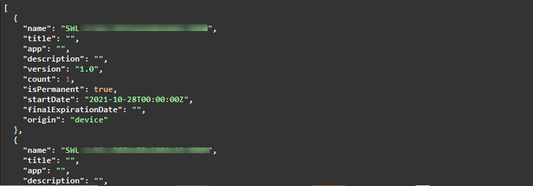
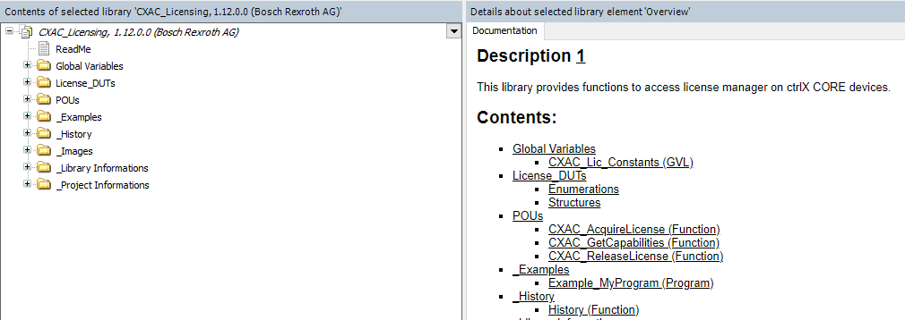
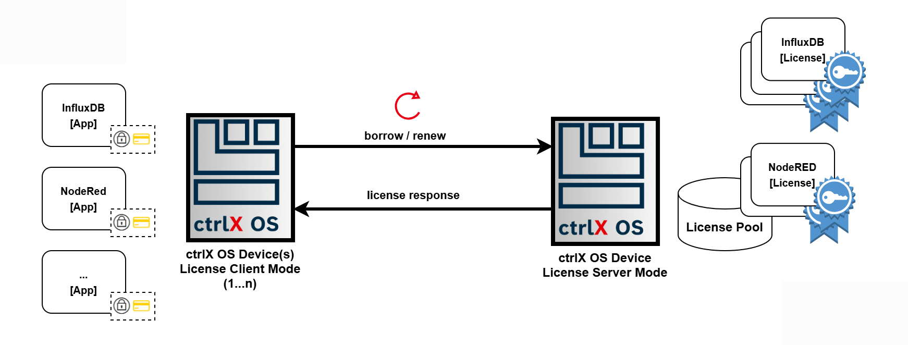
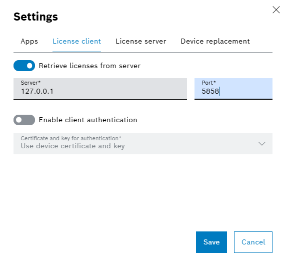
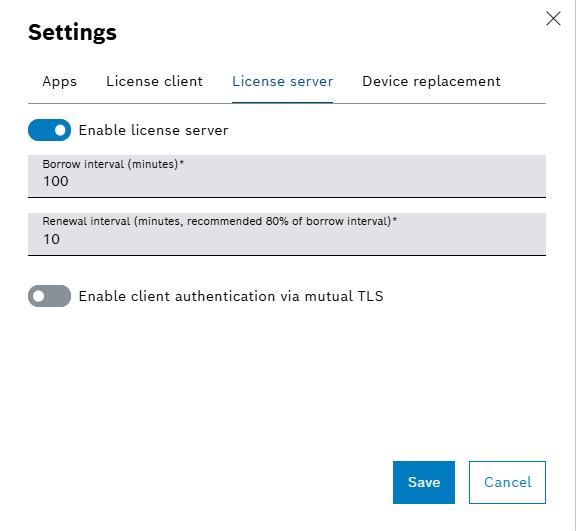

<!-- markdownlint-disable MD025 -->
<!-- markdownlint-disable MD033 -->
<!-- markdownlint-disable MD060 -->
# Introduction

This document is part of the Bosch Rexroth ctrlX OS App Development Guideline, and describes how to adapt to the the license management of the device.

Please refer to the App Development Guide for further information.

## **Table of Contents**

[1 Introduction](#introduction)

[1.1 Make a license available on the device](#device_provisioning)

[2 License Types and Usage Scenarios](#modes)

[2.1 Overview](#overview)

[2.2 Standard App License](#main)

[2.3 ctrlX OS Temporary Usage Rights (Emergency Mode)](#emergency)

[2.4 ctrlX OS 10 Day Trial License](#trial)

[2.5 ctrlX OS 10 Day Trial Mode](#trial_mode)

[2.6 Four Hour Engineering Demo License on ctrlX CORE<sup>virtual</sup>](#virtual)

[2.7 ctrlX OS 3-Month Test License](#test)

[3 License Enforcement](#enforcement)

[3.1 Add Content Plug to snapcraft.yaml](#plug)

[3.2 Adapt package-manifest.json](#manifest)

[3.3 Use API to Enforce Licenses](#rest)

[3.3.3 Verify license response signatures](#spoofing)

[3.4 Communicate with License Manager API](#comm)

[3.5 Access License Manager in PLC Application](#plc)

[3.6 License Management in Windows Applications](#windows)

[4 Floating Licenses](#floating_global)

[4.1 Floating License Client](#floating_license_client)

[4.2 Floating License Server](#floating_server_mode)

[4.3 Licensing Certficate Store](#licensing_cert_store)

# 1 Introduction <a name="introduction"></a>

Bosch Rexroth provides the ctrlX Device Portal at [https://ctrlx-deviceportal.boschrexroth.com/deviceportal](https://ctrlx-deviceportal.boschrexroth.com/deviceportal) for managing device licenses and assigning them to devices. A capability response contains the licenses assigned to a specific device.

ctrlX OS devices with a device certificate that are registered in the Device Portal can automatically connect to the portal and retrieve licenses assigned to them. This is device-level provisioning; applications continue to acquire, verify, and release licenses through the License Manager API. Applications must still handle cases where a license is not yet available when requested.

The ctrlX OS user interface provides a license page to upload a capability response and check which licenses are currently available on the device. For applications, ctrlX OS provides a REST API over an internal Unix domain socket to request and release licenses.

## 1.1 Make a license available on the device <a name="device_provisioning"></a>

1. Assign the required license to the device in the ctrlX Device Portal.
2. If the ctrlX OS device has a device certificate, internet access and is registered in the portal, it can retrieve assigned licenses automatically. Check the device's license page to trigger synchronization and to confirm the license is available.
3. If automatic retrieval is not available, download the capability response from the portal and upload it using the device's license page. Then confirm the license is available on the device.
4. Once the license is available, the application acquires it through the License Manager API. Assigning or provisioning a license does not itself acquire it for an application.

# 2 License Types and Usage Scenarios  <a name="modes"></a>

## 2.1 Overview <a name="overview"></a>

License management in **ctrlX OS** covers different license types and operating scenarios. The following table provides an overview.

| Scenario | When it applies | App configuration or request | App behavior |
|---|---|---|---|
| Standard app license | A customer assigns the app's license to a ctrlX OS device. | Declare the app license in the package manifest and acquire it through the License Manager. | Run when acquisition succeeds; tell the user if the required license is unavailable and periodically verify it. |
| Temporary usage rights | ctrlX OS is in the 10-day emergency period after device replacement. | Acquire the app's standard license through the License Manager. | Treat a successful acquisition with `tampered: true` as licensed. |
| 10-day trial license | A device-specific trial license has been assigned to the device. | Acquire the app's standard license through the License Manager. | Treat successful acquisition as licensed. `isPermanent: false` means non-permanent and does not by itself identify a trial license. |
| 10-day trial mode | Trial mode is enabled for an app that supports it. | Set `supportsTrial: true` for applicable licenses in the package manifest; use the License Manager API. | The response has `tampered: true`; treat a successful acquisition as licensed. This flag is also used for Temporary Usage Rights, so it does not distinguish the two scenarios by itself. |
| Four-hour engineering demo license | An app runs on ctrlX CORE<sup>virtual</sup>. | Request `SWL_XCR_ENGINEERING_4H` as an alternative to the app-specific license. | Allow operation with this license for evaluation; ctrlX CORE<sup>virtual</sup> shuts down after four hours. |
| Three-month test license | An app is in beta/prototype (B-Sample) phase. | Contact Bosch Rexroth; this is not generally available to partner apps. | Support it only when explicitly made available. |

!!! important
    - For evaluation on ctrlX CORE<sup>virtual</sup>, we recommend supporting both the app's standard license and the `SWL_XCR_ENGINEERING_4H` license. More information is provided below.
    - For storing the license ID, it's recommended to use `/tmp`. This folder is accessible from the snap by default. Users can easily write the ID to `/tmp/myFancyFile`, which remains available until the system reboots, even after the app is removed.

### ctrlX CORE<sup>virtual</sup>

As shown in the table, **ctrlX CORE<sup>virtual</sup>** supports only the four-hour engineering demo license. This license lets you evaluate a new app for a limited time; after four hours, **ctrlX CORE<sup>virtual</sup>** shuts down automatically to prevent productive use.

When your app runs on **ctrlX CORE<sup>virtual</sup>**, your app should query the `SWL_XCR_ENGINEERING_4H` license and, if the license is available, enable the app's functionality.

### All other cases

The following sections describe these license types and operating scenarios, including how the app is expected to behave in each case.

## 2.2 Standard App License <a name="main"></a>

**Purpose:** The app-specific license(s) purchased by a customer for normal use.

**Description:**

- For apps that require licensing, support for the app-specific standard license is **mandatory**. The app must acquire and release it through the License Manager; individual licensing implementations are not permitted.
- The customer obtains the license through the Bosch Rexroth ctrlX Device Portal and assigns it to a specific device. See [Make a license available on the device](#device_provisioning) for the provisioning steps.
- The license can be permanent (unlimited) or time-based (expires).

**Expected App Behaviour**:

- Start the licensed functionality after successful acquisition of the standard license or another applicable license described in this section.
- If no applicable license can be acquired, inform the user that a license is required.
- Follow the acquisition, periodic verification, retry, and release guidance in [License Integration](#rest).

Note that for time-based licenses, the license manager will automatically warn (diagnostic alarm) when the time-based license is about
to expire (1 month before expiration, 7 days before expiration and 1 day before expiration). After a time-based license expires, subsequent acquisition requests for it will fail.

## 2.3 ctrlX OS Temporary Usage Rights (Emergency Mode)  <a name="emergency"></a>

**Purpose:** Emergency Device Replacement

**Description:**

- In ctrlX OS, the user has the possibility to activate a special mode that is called "Temporary usage rights". The mode can be activated using the License Manager UI.
- Enabling this mode allows users to operate ctrlX OS in a productive environment for ten consecutive days. The single purpose of this mode is to prevent a downtime when a defect device is replaced and no licenses have been assigned, yet. ==**This mode can only be activated once on a device.**==
- Within these ten days, the user has to either add licenses to the new device or move the licenses from the broken device to the replacement device.

!!! warning
    After ten days, the mode will expire and cannot be reactivated.

**Expected App Behaviour:**

- Support of this license is **mandatory**.
- The app is able to detect whether the system runs in this mode by evaluating the `tampered` flag in the response to the acquisition request (the flag is set to `true`)
- When this mode is active, the app should work as if a standard license is available.

## 2.4 ctrlX OS 10 Day Trial License  <a name="trial"></a>

**Purpose:** Trial license file specific to the device ID for testing purposes

**Description:**

- The 10 day trial license is a real license that is generated from the license center for a specific device ID
- The 10 day trial license allows to use all apps which licenses are included in the trial license file for a restricted time for testing purposes.
- This license is intended exclusively for test and evaluation purposes and must not be used in a production environment.
- The license expires automatically after 10 days.
- 10 day trial licenses may be used (consecutively) in case an according contractual agreement is available for all involved parties (Bosch Rexroth, Customer, ctrlX World Partner).

**Expected App Behaviour:**

- Support of this mode is **optional**, the App may decide, whether its' licenses should be included inside the trial-license file
- The acquisition response may have `isPermanent` set to `false`, indicating a non-permanent license. This flag does not by itself identify a 10-day trial license because standard licenses may also be time-based.
- When this mode is active, the app should work as if a standard license is available.

## 2.5 ctrlX OS 10 Day Trial Mode <a name="trial_mode"></a>

**Purpose:** Test applications without an actual license for 10 days

The 10-day trial mode is an optional feature that an application can support. If enabled, it allows users to activate a 10-day trial period during which the application can be used as if the required licenses were available on the system.

To support this feature, the application only needs to be configured in the package manifest. Specifically, the license object must be extended with a **supportsTrial** property set to true.

```json
"licenses": [
  {
    "name": "SWL-XCx-FRW-FIREWALLxxxxx-NNNN",
    "title": "ctrlX OS License - Advanced Firewall",
    "description": "Industrial firewall for ctrlX OS",
    "required": true,
    "supportsTrial": true,
    "supportsFloating": true,
    "i18n": "licenses.SWL-XCx-FRW-FIREWALLxxxxx-NNNN"
  },
  {
    "name": "SWL-XCx-FRW-FIREWALLxxxxx-BANN",
    "title": "ctrlX OS License - Basic Firewall",
    "description": "Industrial firewall for ctrlX OS with basic features",
    "required": true,
    "supportsTrial": true,
    "supportsFloating": false,
    "i18n": "licenses.SWL-XCx-FRW-FIREWALLxxxxx-BANN"
  }
],
```

**Expected App Behaviour:**

- When trial mode is active, the acquisition response has `tampered` set to `true`. Treat a successful acquisition as licensed.
- Temporary Usage Rights also sets `tampered` to `true`, so this flag alone does not distinguish trial mode from emergency mode. In either case, the app should work as if a standard license is available.

In the example above, if the user enables trial mode for the app, both licenses (**ctrlX OS License – Advanced Firewall** and **ctrlX OS License – Basic Firewall**) become available on the system because both have `supportsTrial` set to `true`. Depending on the use case, trial support can also be enabled for only a subset of licenses.

Once activated, trial mode remains active for 10 days and cannot be reactivated afterward. It can only be enabled once per app (provided the app supports this feature). Trial mode is intended primarily for testing purposes and not for productive use.

The key difference between a 10-day trial license and trial mode is as follows: A trial license (see [2.4 ctrlX OS 10 Day Trial License](#trial)) is an actual license file generated by the License Center and tied to a specific device ID. In contrast, trial mode allows an application to be used temporarily without a license file, as long as trial support is declared in the app's package manifest.

## 2.6 Four Hour Engineering Demo License on ctrlX CORE<sup>virtual</sup> <a name="virtual"></a>

**Purpose**: Evaluation mode on a ctrlX CORE<sup>virtual</sup>
**Description**:

- A special license (`SWL_XCR_ENGINEERING_4H`) indicates that currently the limited evaluation mode is active.
- After 4 hours the ctrlX CORE<sup>virtual</sup> is automatically shut down to prevent a productive use.

**Expected App Behaviour:**

- In order to support this non-productive mode, apps must check for the license `SWL_XCR_ENGINEERING_4H` (in addition to the app's standard license)
- Support for this mode is **optional** yet *highly* **recommended**, offering users a great opportunity to fully experience the application's capabilities and functionalities within
an engineering environment, e.g. ctrlX Works

## 2.7 ctrlX OS 3-Month Test License <a name="test"></a>

**Purpose:** Time limited test and evaluation of apps which are in beta/prototype phase (B-Sample phase)

**Description:**

- This license is not generally available to partner apps by default.
- Contact Bosch Rexroth if this license may be of interest.

# 3 License Enforcement <a name="enforcement"></a>

To integrate an app into the license management, please follow the instructions below.

## 3.1 Add Content Plug to snapcraft.yaml <a name="plug"></a>

To get access to the unix domain socket that provides the restful API, add the following content plug definition to the snapcraft.yaml:

```yaml
plugs:
  licensing-service:
    interface: content
    content: licensing-service
    target: $SNAP_DATA/licensing-service
```

This will create a folder "licensing-service" during installation of the app in ctrlX OS and provide access to the unix domain socket "licensing-service.sock" which will be located in the folder.

## 3.2 Adapt package-manifest.json <a name="manifest"></a>

The app shall provide information in the package-manifest about each license that is supported. Description and title shall be human readable.
The "required" flag indicates whether a license is mandatory to use the application. Set the flag to true when the license is required and to false, when the license is optional. Multiple licenses can have the "required" flag set to true simultaneously. In this case, the app must ensure that it works if any of the 'required' licenses is available.

  ```json
   "licenses": [
      {
        "name": "SWL-XCx-RUN-DLACCESSNRTxx-NNNN",
        "title": "ctrlX OS License - Customer App",
        "description": "Integration of customer apps into ctrlX OS with access to the ctrlX Data Layer",
        "required": true
      }
    ],
```

## 3.3 Use API to enforce licenses <a name="rest"></a>

### 3.3.1 License Integration

How an app reacts when no license is present or the license is removed during runtime, can be freely chosen by the app. Nevertheless, to provide a unique user experience across multiple apps, the following best practices are recommended.

The License Manager records license-related diagnostics in the ctrlX Logbook. The app may also log useful app-specific context, but should not duplicate License Manager entries or write repeated messages at retry or periodic-check frequency. Rate-limit or aggregate recurring messages to avoid flooding the Logbook.

#### Acquire and use

Acquire a license when the app or licensed functionality starts. Start the functionality only after acquisition succeeds, and keep the license acquired while it is in use. It is not recommended to use a capability query alone or a one-time acquire/release sequence as a preflight check before starting the licensed functionality.

#### Periodically verify

Periodically verify the license by releasing and reacquiring it, for example every 15 minutes. The interval is an example, not continuous validation: an expired or unavailable license may not be detected until the next check. Reacquire after each check if the licensed functionality is still needed. If any one of several licenses can authorize the same functionality, try candidates in a defined order during initial acquisition and stop at the first success. Remember that candidate and try it first during each periodic check; if it is no longer available, try the alternatives and remember the next successful candidate. Rembering the last successfull candidate and trying that first is particularly important for floating licenses where each unsuccessful local acquisition request from the app could trigger a full license request to a floating license server (if enabled).

For floating licenses, the License Manager attempts to renew tracked licenses according to the configured renewal interval. An acquired license already present in local storage may not be tracked for renewal. Automatic renewal does not replace the app's periodic release/reacquire check; the app is not directly notified of a background renewal failure. Handle a failed reacquisition according to the app's chosen behavior.

#### Handle unavailable licenses

If license acquisition fails because no suitable license is available, inform the user which license is needed. Retry the acquisition at a defined interval, for example once per minute, while the licensed functionality is still requested. Avoid tight-loop retries or excessive request rates that could overload the License Manager. Serialize acquisition, periodic checks, retries and release for the same license so that requests do not overlap. Stop retrying when the functionality is no longer needed or the app is stopped.

A request timeout or connection loss does not prove that the License Manager failed to process the request. An acquire may have succeeded without the app receiving its ID; a release may already have completed. Do not treat these outcomes as a definite rejection or blindly issue overlapping acquire requests. Handle recovery according to the application's licensing policy, adding an app log entry only if it provides context beyond the License Manager's Logbook entry.

If a license becomes unavailable while the app is running, each app provider must assess the consequences of interrupting the affected licensed functionality and define the app's response accordingly. Do not assume that abruptly stopping the app or disabling the feature is safe: depending on the application, this may create a safety hazard or disrupt machine operation. If interruption could be hazardous, follow the system's designed controlled-shutdown or safe-state procedure before stopping the functionality. Inform the user. Add an app log entry only if it provides useful context beyond the License Manager's Logbook entry.

#### Release when no longer needed

Release the license without reacquiring it when the licensed functionality is no longer needed, or when the app is stopped or uninstalled. This releases the local license instance so it can be acquired again on the device. For floating licenses, local release does not guarantee that the server seat is returned immediately; it may remain allocated and renewed until the License Manager returns it or the borrow interval expires without renewal.

A stored license ID can be reused to release a ticket after an app restart, but may no longer be known after the License Manager restarts. Releasing an unknown ID returns HTTP 404 and does not release another license. Discard the stale ID and acquire a new instance if the functionality is still needed.

!!! important
    On ctrlX OS devices, when enforcing licenses the use of the license management is mandatory. Individual implementations are not permitted.

### 3.3.2 License Manager API

The licensing API is available on GitHub: [https://boschrexroth.github.io/rest-api-description](https://boschrexroth.github.io/rest-api-description)

The ctrlX OS License Manager API streamlines license management for the ctrlX OS. This API documentation is also available in the API Reference Section of ctrlX OS. It provides clear guidance on acquiring, releasing, querying, and managing licenses for different applications or functions. The REST API functionality allows users to test their license features and confirm their operability. **The use of unix sockets for license integration is recommended. Refer to section 3.4 for details.**

Implementing this API, an app is able to

- Get a list of all available license capabilities.
- Acquire a license.
- Release a license.
- Update the licenses on a ctrlX OS device by uploading a license file.

| Operation | Method | Endpoint | Notes |
|---|---|---|---|
| Get activated capabilities | GET | `/capabilities` | Returns licenses available on the device. |
| Acquire a license | POST | `/license` | Send a license name and version; optionally set `signResponse`. |
| Release a license | DELETE | `/license/{id}` | Use the ID returned by the acquire request. |
| Update capabilities | PUT | `/capabilities` | Upload a capability response file; optionally set `withChangeReport`. |
| Get the device certificate chain | GET | `/device-certificate-chain` | Used to verify signed responses and client certificates. |

### 3.3.3 Verify license response signatures <a name="spoofing"></a>

**Purpose:** This mechanism allows applications that request a license to verify that the license indeed comes from the ctrlX OS license manager.

**Description:**

- Although it is quite improbable, that a malicious actor could replace ctrlX OS license manager, a further layer of security is added
- Applications can request licenses (see [License Manager API](https://boschrexroth.github.io/rest-api-description/ctrlx-automation/ctrlx-core/)) and set the 'signResponse' query parameter
- Once a license has been requested (with the corresponding query parameter set) the response's header will contain a signature
- This signature was calculated using the device certificate (and the corresponding tpm-based key) and can be used to fully verify that the license response was indeed from a certified ctrlX OS device with no spoofed license manager

**Usage:**

1 - Any application that wants to use this mechanism will need to send a license request with the corresponding query parameter set <br>

- 1.1 - The response header contains a hex-encoded signature ("Payload-Signature") <br>
- 1.2 - The signature is created using ECDSA-SHA256 on the standardized curve 'SECP-256' <br>

2 - Once the response (and the signature in 'Payload-Signature') is received the application needs to verify that the signature is indeed valid and was produced by the device <br>

- 2.1 - The license manager's device certificate chain (and the public key herein) can be used for this - see (see [License Manager API](https://boschrexroth.github.io/rest-api-description/ctrlx-automation/ctrlx-core/)) <br>
- 2.2 - Use the public key inside the end-entity (device) certificate to verify the signature <br>

3 - Once signature verification is successful, we can assume that the chain sent by the device and the key used for signing correspond, however additional steps are required to ensure that the device is indeed a ctrlX OS device (and the license manager is unaltered) <br>

- 3.1 – Use the device certificate chain retrieved in step 2.1 to check whether the device is a genuine ctrlX OS device. <br>
- 3.2 – To do this, your app needs the ctrlX OS root CA certificate (`com.ctrlx-automation.os.crt`). We recommend embedding this certificate in your app's binaries so that it cannot be replaced or spoofed by a malicious party. <br>
- 3.3 – Verify the certificate chain from the device certificate up to the ctrlX OS root CA certificate. If verification succeeds, the device certificate was issued by an authorized ctrlX OS party and the device is a genuine ctrlX OS device. <br>


**Note:**
As there are multiple steps involved here (where some of them might be time consuming due to cryptographic complexity) it is the app's responsibility whether it wants to check this once during startup, according to a defined interval, etc. Please note the general perception is that - if this feature is required - checking it during startup suffices to verify the integrity of the license manager.

**ctrlX OS root CA certificate:**
As stated in step 3.2, the application needs to know the ctrlX OS root CA certificate (com.ctrlx-automation.os.crt). If this feature is required, the corresponding certificate needs to be embedded inside the application. The ctrlX OS root CA certificate can be retrieved via the following link: <br>

[Download ctrlX OS root CA certificate (com.ctrlx-automation.os.crt)](certificates/com.ctrlx-automation.os.crt)

### 3.3.4 Acquiring & releasing a license <a name="acquire_release"></a>

When starting an application or service that requires a license, it must acquire the necessary license to operate. Acquiring a license generates a unique ID specific to that license. The POST API call /license will acquire the license when passed with parameter as shown below.

```json
{
  "name": "SWL-XCx-FRW-BASIC_FOOBAR-NNNN",
  "version": "1.0"
}
```

Upon a successful request, the following response will be returned.

```json
{
  "isPermanent": false,
  "endDate": "2030-01-01T12:00:27.7+00:20",
  "name": "SWL-XCx-FRW-BASIC_FOOBAR-NNNN",
  "id": "0083d875-30e8-4ff6-9f92-46096ef2d123",
  "version": "1.0",
  "startDate": "2030-01-01T12:00:27.87+00:20"
}
```

!!! warning
    Each successful acquire request returns a license instance with its own ID. Acquiring the same license again without first releasing the existing instance can fetch another instance from the license server and consume an additional floating-license seat. During periodic checks, release the current instance by its ID before reacquiring it.

Use the ID returned by the acquire response to release the license. Follow the [license lifecycle and periodic verification guidance](#rest) while the functionality is in use. Store the ID somewhere the app can access after an app restart, for example in `/tmp`. A stored ID may no longer be valid after a License Manager restart; see [Release when no longer needed](#rest).

### 3.3.5 Available licenses on the device (activated capabilities)

An app can retrieve the list of licenses available on the device, including metadata such as expiration dates and license counts. This lets the app check how many units of a specific license are still available (not in use) before trying to acquire one.

This step is optional. For most apps, it is sufficient to request the license and check whether the request succeeded. Note that the list only covers licenses stored locally on the device. In some use cases, such as floating licenses, the license might not be on the device yet, so it won't appear in the list even though it can still be acquired.

Sample response:

> 

### 3.3.6 Update license status

Device operators can use the API to upload a capability response (license file) from the license portal and update the license status on the device, for example to add new licenses. This is a manual alternative to automatic license retrieval on eligible ctrlX OS devices. It is not the app's responsibility.

The REST API route for uploading a license file accepts an optional query parameter, `withChangeReport`. If this parameter is set, the response lists all licenses that the uploaded license file added or removed.

## 3.4 Communication with License Manager API <a name="comm"></a>

### 3.4.1 Unix domain socket

The content interface from step 3.1 provides access through a Unix domain socket, `licensing-service.sock`, located at `$SNAP_DATA/licensing-service/licensing-service.sock`. You can call all licensing APIs directly through this socket using any HTTP client. Most programming languages offer HTTP clients that support Unix domain sockets, so you can access the licensing API the same way from your app's code.

We recommend using the Unix domain socket because it requires no authentication, so your app doesn't need to obtain an authorization token.

#### Check whether the plug is connected

```bash
if [ -d "$SNAP_DATA/licensing-service" ]; then
  echo "Licensing plug connected: true"
else
  echo "Licensing plug connected: false"
fi
```

#### Examples using curl

The following examples use a relative socket path, so first change to the `$SNAP_DATA` directory:

```bash
cd $SNAP_DATA
```

**Get capabilities:**

```bash
curl -sS --no-buffer -X GET --unix-socket licensing-service/licensing-service.sock \
  http://localhost/license-manager/api/v1/capabilities
```

**Acquire a license:**

This example acquires the four-hour engineering license for ctrlX CORE<sup>virtual</sup>. To acquire a different license, replace `SWL_XCR_ENGINEERING_4H` with the license feature code returned by the capabilities request.

```bash
curl -sS --no-buffer -X POST --unix-socket licensing-service/licensing-service.sock \
  'http://localhost/license-manager/api/v1/license' \
  -H 'accept: application/json' \
  -H 'Content-Type: application/json' \
  -d '{"name":"SWL_XCR_ENGINEERING_4H","version":"1.0"}'
```

**Release a license:**

Replace the ID in the URL with the license ID returned when you acquired the license.

```bash
curl -sS --no-buffer -X DELETE --unix-socket licensing-service/licensing-service.sock \
  'http://localhost/license-manager/api/v1/license/57ac4c58-4167-4afb-b4c2-e63c564c5b68'
```

#### Store the license ID

Your app needs the license ID to release the license later, so store it after acquiring the license. We recommend storing it in the `/tmp` folder, which your snap can access by default. Files in `/tmp` remain available until the system reboots.

```bash
# Assumes the license ID is stored in the variable "myid"
licensefilelocation=/tmp/LICENSED
echo "$myid" > "$licensefilelocation"
```

## 3.5 Access License Manager in PLC Application <a name="plc"></a>

### 3.5.1 ctrlX AUTOMATION Library *CXA_LICENSING*

In addition to the REST API, the License Manager can also be used in a PLC application.
To use the according functions, the library *CXA_LICENSING* can be added to a PLC application in the Library Manager.

Please refer to the ctrlX PLC Engineering documentation for information about the Library Manager.

### 3.5.2 Supported functions

The *CXA_LICENSING* library provides POUs to acquire and release licenses and to get capabilities. In addition, the library also comes with an example how to use the licensing mechanisms in a PLC application.

The online documentation of the library in ctrlX PLC Engineering provides detailed information about the POUs and the example:
> 

## 3.6 License Management in Windows Applications <a name ="windows"></a>

ctrlX WORKS also supports the License Manager.

Please find the ctrlX WORKS Licensing API here in the ctrlX OS Ecosystem Portal:
[ctrlX WORKS Licensing API](https://bosch.sharepoint.com/sites/msteams_1647245/Shared%20Documents/Forms/AllItems.aspx?id=%2Fsites%2Fmsteams%5F1647245%2FShared%20Documents%2FPartner%2F01%5FctrlX%2DOS%2DEcosystem%5Fgeneral%5Finformation%2F03%5FApp%5FDevelopment%2FWindows%5Flicensing&viewid=8b8e06ca%2D17db%2D4be0%2D9e39%2D9075f4b21066)

The access is restricted for ctrlX World Partners and ctrlX OS OEM - [registration here](https://www.ctrlx-os.com/en/ctrlx-world/ctrlx-os-ecosystem-portal/).

This API provides licensing functions for Windows Applications, and comes with according samples for different programming languages and frameworks.

# 4 Floating Licenses <a name ="floating_global"></a>

Floating licenses are *special* licenses that are borrowed from a license server for a defined time interval. In a typical scenario the
client (e.g. a ctrlX OS device in client mode) requests a floating license from a license server (e.g. a ctrlX OS device in license server mode).
Both modes are supported by the license manager and are explained throughout the following chapters.

> 

## 4.1 Floating License Client <a name ="floating_license_client"></a>

It is assumed that the application is already integrated inside the licensing infrastructure as described within [License Enforcement](#enforcement).
The integration and usage of a floating license in addition to an existing non-floating license includes following steps:

1. Globally enable floating functionality inside the license manager
    - A license server endpoint must be configured and contacting the license server must be explicitly enabled. These are part of the client settings
    and are usually configured once by a system administrator.
2. Extend the application's [package-manifest.json](#floating_manifest) file by the additional property to support floating

### 4.1.1 Enabling floating license functionality

When an application requests a floating license from the license manager, it is first checked whether contacting a floating license server is enabled. Enablement is
usually performed by a system administrator during device configuration and can be done via the settings of the license manager. Only if floating functionality is enabled,
the license manager (in client mode) will try to contact a configured license server to retrieve its licenses from.

> 

### 4.1.2 Adapt package-manifest.json <a name="floating_manifest"></a>

**Enable floating capability for an App**

The app provider can specify whether an app’s license(s) support floating, meaning the license can be retrieved from a floating license server. To enable this functionality, the application must extend the package manifest by setting the **supportsFloating** property to *true*.

When this property is enabled, the license manager attempts to obtain the license from a configured floating license server if no local license is available on the system.

The following example declares that the **ctrlX OS License - Advanced Firewall** license can be floating, i.e. retrieved from a floating license server.
The **ctrlX OS License - Basic Firewall** doesn't have the **supportsFloating** property set, thus requests will not be redirected to a configured server.

```json
"licenses": [
  {
    "name": "SWL-XCx-FRW-FIREWALLxxxxx-NNNN",
    "title": "ctrlX OS License - Advanced Firewall",
    "description": "Industrial firewall for ctrlX OS",
    "required": true,
    "supportsTrial": true,
    "supportsFloating": true,
    "i18n": "licenses.SWL-XCx-FRW-FIREWALLxxxxx-NNNN"
  },
  {
    "name": "SWL-XCx-FRW-FIREWALLxxxxx-BANN",
    "title": "ctrlX OS License - Basic Firewall",
    "description": "Industrial firewall for ctrlX OS with basic features",
    "required": true,
    "supportsTrial": true,
    "supportsFloating": false,
    "i18n": "licenses.SWL-XCx-FRW-FIREWALLxxxxx-BANN"
  }
],
```

### 4.1.3 Requesting a floating license

The same mechanism to acquire / release a license by an application as described in [API](#rest) can be used for floating
licenses. It is transparent for the application whether the license is retrieved from the internal on-device license storage or from a configured
license server. The entire handling of connecting to a configured license server, generating a request and retrieving / processing the license response is encapsulated within the license manager.

Follow the [license lifecycle and periodic verification guidance](#rest). The License Manager attempts to renew tracked floating licenses according to the configured renewal interval. A license acquired from local storage may not be tracked for renewal; if it expires, a subsequent reacquisition can trigger a request to the configured server. Releasing the local instance does not guarantee an immediate return of the floating seat to the server.

## 4.2 Floating License Server <a name="floating_server_mode"></a>

### 4.2.1 Enabling the floating license server <a name="enable_license_server"></a>

The floating server can be enabled via the settings page. If no *ctrlX OS - Floating License Server* license is available, the borrow interval cannot be set by the user and is fixed at 7 days, meaning that a client requesting a license will have the license for 7 days until it expires.

If the corresonding *ctrlX OS - Floating License Server* license is available on the server, the user can configure the borrow and renewal interval. The borrow interval determines for how long the license will be valid on the client, whereas the renewal interval dictates the frequency at which the client tries to renew the licenses that are currently in use.

  ```json
  "licenses": [
    {
      "name": "SWL-XCx-FLS-FLOATxSERVERx-NNNN",
      "title": "ctrlX OS License - Floating License Server",
      "description": "Enables using the device as a (floating) license server",
      "required": false,
      "i18n": "licenses.SWL-XCx-FLS-FLOATxSERVERx-NNNN"
    }
  ],
```

### 4.2.2 Floating License Server Settings <a name="floating_server_settings"></a>

If the floating license server is enabled, the settings page will adjust to the settings that can be made to the floating
license server. As the following image shows, these settings include following:

> 

**Server Intervals**
control for how long licenses borrowed from the server will be valid and the interval at which the clients should renew its' licenses.

- Borrow Interval:
  - The borrow interval (in seconds) determines the lifespan of the served licenses. If a license is not renewed before
  the interval expires, it expires on the client and the server can reclaim the seat. The server's displayed client records
  may remain visible for some time even after expiry. In the exemplary image the license would be served for 24 hours unless it is renewed.
- Renewal Interval:
  - The renewal interval (in seconds) is used by licensing clients to determine when to renew its' licenses / update it's
  current licenses with the license server. In the exemplary image the client would try every 3 hours to renew its license
  that are currently tracked. A renewal might return previously released licenses, but local release alone does not guarantee
  that they are excluded from subsequent renewals or returned to the server. Lower renewal intervals mean more frequent updates
  with the license server, but also higher load on the licensing client and server.

**Client Authentication**
The administrator of the floating license server can also decide how the client needs to authenticate itself in order to
be able to request and be granted floating licenses from the server. If the checkbox is activated, the server requests the
client to authenticate itself via mutual TLS. This means that the client is expected to send a certificate which the server
then verifies. If the checkbox is activated the selector allows two configurations:

1. Manually trust client certificates:
   - If this mode is activated, the server will verify the certificate using the chosen CA certificates and implicitly the
   [ctrlX OS root CA certificate](certificates/com.ctrlx-automation.os.crt). If certificate verification is successful, the
   certificate will be placed into the certificate store *Licensing* under category untrusted. Only after the administrator
   has manually *trusted* the certificate (e.g. placed into category trusted), the client will be able to successfully receive
   floating clients. The concept is similar to how the OPC UA protocol works in regard to certificates / trust. The advantage
   is that within this mode, the system administrator has full control over what devices should be granted access to the floating
   licenses - however manual interaction is always required (whitelisting).
2. Automatically trust client certificates
   - If this mode is activated, the server will verify the certificate using the chosen CA certificates and implicitly the
  [ctrlX OS root CA certificate](certificates/com.ctrlx-automation.os.crt). Upon successful certificate validation, the server
  will directly respond to the client request without manual intervention (e.g. click button "trust"). The main advantage is that
  the license server will automatically serve ctrlX OS devices upon successful verification against the specified CA certificates
  without manual interaction by a system administrator. However - if access shall not be granted to specific devices, these devices'
  certificates would need to be manually added to the certificate store *Licensing* under category untrusted (blacklisting).

## 4.3 Licensing Certficate Store <a name="licensing_cert_store"></a>

Depending on the authentication scheme configured on the license server ([see here](#floating_server_settings)), the client can be forced to authenticate itself (mutual TLS). Furthermore the server allows configuring CA certificates against which the client certificate is verified.

These certificates (and keys) can be selected from a dedicated certificate store (*Licensing*).

***
**Copyright**
SPDX-FileCopyrightText: Bosch Rexroth AG
